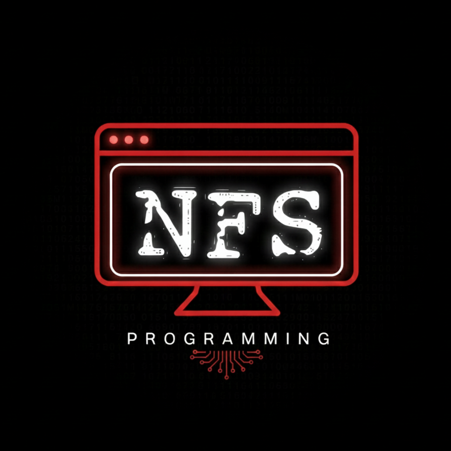

<div align="center">
  
  <h1>NFS Programming Portfolio</h1>
  <p><strong>Cutting-edge 3D interactive developer portfolio and digital experience platform.</strong></p>
  <p>
    <a href="#overview">Overview</a> •
    <a href="#features">Features</a> •
    <a href="#tech-stack">Tech Stack</a> •
    <a href="#project-structure">Project Structure</a> •
    <a href="#getting-started">Getting Started</a> •
    <a href="#deployment">Deployment</a> •
    <a href="#license">License</a>
  </p>
</div>

---

## Overview

**NFS Programming Portfolio** is a modern, high-performance portfolio web application built with **React 19**, **Vite**, **Three.js / React Three Fiber**, and **Framer Motion**. Designed as an immersive showcase for a Full-Stack Software Engineer & AI Solutions Architect, it features real-time 3D interactive canvases, physics-based smooth scrolling, responsive fluid auto-layouts, an in-browser interactive terminal, and a developer HUD diagnostic dashboard.

---

## Features

- **Interactive 3D Graphics**:
  - **Dynamic Particle Field (`Background3D`)**: Hardware-accelerated particle system rendered with Three.js and `@react-three/fiber`.
  - **Interactive 3D Skill Sphere (`SkillSphere`)**: Rotating tag-cloud globe built with `@react-three/drei` and `@react-three/fiber` mapping core proficiencies.
  - **3D Parallax & Tilt Effects (`TiltCard`, `Parallax3D`)**: Smooth cursor-tracking perspective tilts and multi-layer parallax shifts.

- **Immersive Micro-interactions & Motion**:
  - **Lenis Smooth Scroll**: Inertial, fluid scroll dynamics across all views.
  - **Scramble Text & Typography Reveals**: Cyberpunk-style text scrambling and scroll-triggered headline reveals.
  - **Custom Magnetic Cursor**: Fluid dot and ring cursor with magnetic attraction to interactive elements.
  - **Animated Timeline**: Scroll-driven SVG path tracing developer career and education milestones.
  - **Terminal Boot Preloader**: Cyber-themed preloader sequence preceding app hydration.

- **Interactive Developer Terminal**:
  - An interactive, simulated CLI in the browser supporting commands such as `help`, `skills`, `projects`, `contact`, `clear`, `about`, `matrix`, and `sudo`.

- **Live Developer Dashboard HUD (`DevModeDashboard`)**:
  - Real-time diagnostic panel displaying active frame rate (FPS), memory footprint, viewport dimensions, screen mode toggles, and component debug triggers.

- **Client-Side Routing & SPA Architecture**:
  - Powered by **React Router DOM v7** with animated page transitions (`/`, `/about`, `/services`, `/experience`, `/skills`, `/projects`, `/contact`).

- **Responsive & Dark Modern Aesthetics**:
  - Fluid typography with CSS `clamp()`, flexible auto-fit grid systems, glassmorphism backdrops, and custom noise grain overlay.

---

## Tech Stack

| Domain | Technologies |
| :--- | :--- |
| **Framework & Runtime** | [React 19](https://react.dev/), [React DOM 19](https://react.dev/) |
| **Build Tool & Bundler** | [Vite 7](https://vite.dev/) |
| **3D & WebGL Engine** | [Three.js](https://threejs.org/), [@react-three/fiber](https://r3f.docs.pmnd.rs/), [@react-three/drei](https://github.com/pmndrs/drei) |
| **Motion & Animation** | [Framer Motion](https://www.framer.com/motion/), [Lenis](https://lenis.darkroom.engineering/) |
| **Routing** | [React Router DOM v7](https://reactrouter.com/) |
| **Icons** | [Lucide React](https://lucide.dev/) |
| **Linting & Code Quality**| [ESLint 9](https://eslint.org/) |
| **Deployment Target** | [Vercel](https://vercel.com/) (configured via `vercel.json` SPA rewrites) |

---

## Project Structure

```text
nfs-programming/
├── public/                       # Static public assets
│   ├── favicon.png               # Browser favicon
│   ├── logo.png                  # Brand logo
│   └── portrait.jpg              # Developer profile photo
├── src/
│   ├── assets/                   # Bundled project assets
│   ├── components/               # Core application sections
│   │   ├── About.jsx             # Biography and background
│   │   ├── Background3D.jsx      # WebGL particle system
│   │   ├── Contact.jsx           # Contact form and channels
│   │   ├── CustomCursor.jsx      # Magnetic custom cursor
│   │   ├── Experience.jsx        # Animated milestone timeline
│   │   ├── Hero.jsx              # Parallax hero section
│   │   ├── Navbar.jsx            # Responsive navigation header
│   │   ├── Projects.jsx          # Showcase of featured works
│   │   ├── Services.jsx          # Service offerings & spotlight cards
│   │   ├── Skills.jsx            # Skill categorization & 3D sphere
│   │   ├── Terminal.jsx          # In-browser CLI emulator
│   │   ├── Testimonials.jsx      # Client recommendations & reviews
│   │   └── Workflow.jsx          # Engineering workflow stages
│   ├── components/ui/            # Reusable UI primitives
│   │   ├── DevModeDashboard.jsx  # Live performance HUD
│   │   ├── Magnetic.jsx          # Magnetic spring wrapper
│   │   ├── PageTransition.jsx    # Route transition animations
│   │   ├── Parallax3D.jsx        # 3D parallax container
│   │   ├── Preloader.jsx         # Terminal boot preloader
│   │   ├── ProgressiveImage.jsx  # Blur-up image loader
│   │   ├── QuickActions.jsx      # Floating speed-dial navigation
│   │   ├── RevealOnScroll.jsx    # Scroll viewport reveal
│   │   ├── ScrambleText.jsx      # Text scrambling effect
│   │   ├── Scroll3DSection.jsx   # 3D tilt scroll section
│   │   ├── SkillSphere.jsx       # 3D interactive tag sphere
│   │   ├── TextReveal.jsx        # Animated text mask reveal
│   │   └── TiltCard.jsx          # Gyro / mouse tilt card
│   ├── App.jsx                   # Application router & master layout
│   ├── App.css                   # Global layout rules
│   ├── grain.css                 # Film grain overlay effect
│   ├── index.css                 # Core CSS design tokens & utilities
│   └── main.jsx                  # React DOM entry point
├── .gitignore                    # Git ignore specifications
├── eslint.config.js              # ESLint configuration
├── index.html                    # HTML entry point with OpenGraph tags
├── LICENSE                       # MIT License
├── package.json                  # Project manifest and scripts
├── vercel.json                   # Vercel SPA routing configuration
└── vite.config.js                # Vite build configuration
```

---

## Getting Started

### Prerequisites

- **Node.js**: `v18.0.0` or higher (Node.js 20+ recommended)
- **Package Manager**: `npm` (v9 or later)

### Installation

1. Clone the repository:
   ```bash
   git clone https://github.com/nfsprogramming/NFS-Programming.git
   cd NFS-Programming
   ```

2. Install dependencies:
   ```bash
   npm install
   ```

### Development

To start the local development server with Hot Module Replacement (HMR):

```bash
npm run dev
```

The application will be available at `http://localhost:5173`.

### Production Build

To build the optimized static assets:

```bash
npm run build
```

Production output will be generated in the `dist/` directory.

### Preview Production Build

To test the generated production build locally:

```bash
npm run preview
```

### Code Quality

Run ESLint across all source files:

```bash
npm run lint
```

Clean build artifacts:

```bash
npm run clean
```

---

## Deployment

The application is optimized for deployment on **Vercel** or any static hosting platform.

For Vercel, the included `vercel.json` ensures all route requests fallback correctly to `index.html` for client-side routing:

```json
{
  "rewrites": [
    {
      "source": "/(.*)",
      "destination": "/index.html"
    }
  ]
}
```

To deploy via Vercel CLI:

```bash
npx vercel
```

---

## Releases & Downloads

Pre-built web distribution bundles and release notes are available on the [GitHub Releases](https://github.com/nfsprogramming/NFS-Programming/releases) page.

---

## Contributing

Contributions, issues, and feature requests are welcome. Feel free to open an issue or submit a pull request.

1. Fork the Project
2. Create your Feature Branch (`git checkout -b feature/AmazingFeature`)
3. Commit your Changes (`git commit -m "feat: Add AmazingFeature"`)
4. Push to the Branch (`git push origin feature/AmazingFeature`)
5. Open a Pull Request

---

## License

Distributed under the **MIT License**. See [`LICENSE`](LICENSE) for more information.
